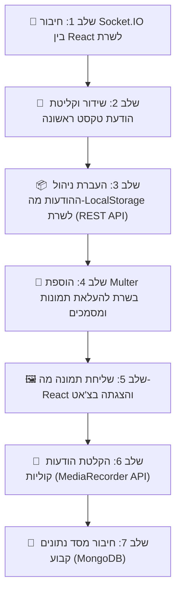

# 🚀 מפת דרכים: לימוד צד שרת ופרויקט ReactChat

מסמך זה מסכם את כל מה שלמדנו, היכן אנחנו אוחזים כרגע, ותוכנית פעולה ברורה להמשך הדרך בלמידה וביישום בידיים (Hands-on).

---

## 📌 1. מה עשינו עד עכשיו?

1. **הבנת הארכיטקטורה:**
   - הבנו מה ההבדל בין קוד לקוח (React שרץ בדפדפן) לקוד שרת (Node.js שרץ כתהליך עצמאי על מערכת ההפעלה).
   - הבנו מדוע השרת הוא ה-**Single Source of Truth** האמיתי, וכיצד React משמש רק כמראה/תצוגה (View).
   - השווינו בין **Node.js** ל-**Java (Spring Boot)** והבנו למה Node.js הוא הבחירה הטבעית לצ'אט (שפה אחידה, Socket.IO מובנה, טיפול פשוט במדיה).

2. **הפרדת הפרויקט (Monorepo בסיסי):**
   - השארנו את תיקיית `.git` בשורש הפרויקט.
   - העברנו את קוד ה-React לתיקיית `client/`.
   - יצרנו תיקיית `server/` נפרדת עם `package.json` משלה בעזרת `npm init -y`.

3. **הקמת שרת ראשון (Express):**
   - התקנו ספריות בסיס: `express`, `cors`, `dotenv`, `socket.io`.
   - יצרנו קובץ כניסה ראשי: `server/index.js`.
   - למדנו על תפקיד ה-Middleware (`app.use(cors())`, `app.use(express.json())`).
   - יצרנו Endpoint ראשון מסוג GET (`/api/test`) והרצנו את השרת על פורט `5000`.
   - בדקנו את תגובת השרת ישירות מהדפדפן.

4. **פירוק מושגי יסוד לעומק:**
   - ניתחנו מה ההבדל בין **HTTP** (בקשה-תשובה, חיבור נסגר, מכתב בדואר) לבין **WebSocket** (קו טלפון רציף ופתוח).
   - למדנו למה שרת WebSocket חייב "לרכוב" על שרת HTTP לצורך ה-Handshake הראשוני.
   - ניתחנו את אובייקט הבקשה: `req.body`, `req.params`, `req.query`, `req.headers`.
   - הבנו למה המרת נתונים ברשת דורשת מחרוזות (`JSON.stringify`) ואיך `res.json()` עושה זאת אוטומטית.
   - הבנו את עקרון העלאת קבצים בינאריים דרך `FormData` ו-`multipart/form-data` עם `multer`.

---

## 📍 2. איפה אנחנו אוחזים כרגע?

- **סטטוס שרת:** יש לנו שרת Express בסיסי עובד.
- **סטטוס סוקטים:** למדנו את התאוריה של Socket.IO, השרת מוכן לשדרוג ל-`http.createServer(app)`.
- **סטטוס לקוח:** קוד ה-React עדיין משתמש ב-`localStorage` לניהול הודעות ומשתמשים.
- **היעד הבא:** חיבור חי של Socket.IO בין ה-React ל-Node.js, ואז העברת ניהול ההודעות מה-LocalStorage לשרת.

---

## 🗺️ 3. תוכנית עבודה להמשך (צעד אחר צעד)

### פירוט השלבים:

#### שלב 1: חיבור בזמן אמת (Socket.IO Handshake)
- שדרוג `server/index.js` לעטיפת `http.createServer(app)`.
- אתחול `new Server(server)` בשרת.
- התקנת `socket.io-client` בתוך תיקיית `client`.
- יצירת קובץ `client/src/socket.js`.
- **בדיקה:** לראות בטרמינל של השרת את ההודעה: `משתמש התחבר עם מזהה X`.

#### שלב 2: הודעת טקסט חיה ראשונה
- ב-React: לחיצה על "שלח" תבצע `socket.emit('send_message', data)`.
- בשרת: מאזינים ל-`socket.on('send_message')` ומשדרים לכולם: `io.emit('receive_message', data)`.
- ב-React: מאזינים בתוך ה-ChatContext ל-`socket.on('receive_message')` ומעדכנים את ה-State.
- **בדיקה:** פתיחת שני חלונות דפדפן במקביל — שליחת הודעה בחלון א' מופיעה מיד בחלון ב'.

#### שלב 3: העברת לוגיקת ההודעות מ-LocalStorage לשרת
- יצירת נתיב `GET /api/messages` לטעינת היסטוריה.
- יצירת נתיב `POST /api/messages` לשמירה ראשונית.
- טעינת ההודעות בהרמת ה-React בעזרת `useEffect` ו-`fetch`.

#### שלב 4 & 5: העלאת מדיה (תמונות ומסמכים)
- התקנת `multer` בשרת: `npm install multer`.
- יצירת תיקיית `server/uploads/` והגדרת הגשה סטטית: `app.use('/uploads', express.static('uploads'))`.
- יצירת נתיב `POST /api/upload`.
- ב-React: הוספת כפתור קובץ `input type="file"`, אריזת הקובץ ב-`FormData`, ושליחה ב-`fetch`.
- שידור הודעת סוקט עם ה-URL שחזר.

#### שלב 6: הודעות קוליות (Voice Notes)
- שימוש ב-`navigator.mediaDevices.getUserMedia` להקלטת קול ישירות מהדפדפן.
- המרת ההקלטה ל-`Blob` (קובץ אודיו `audio/webm`).
- שליחת ה-Blob כקובץ לשרת באותו נתיב העלאה (`POST /api/upload`).
- הצגת תגית `<audio controls src="..." />` בבועת ההודעה בריאקט.

#### שלב 7: מסד נתונים (MongoDB)
- מעבר ממערכים זמניים בזיכרון ה-RAM למסד נתונים אמיתי שנשמר לתמיד.

---

## 📚 4. איך להתקדם נכון בלימודי צד שרת?

1. **תמיד לבנות בידיים (Hands-on):** אל תעתיק בלוקים של קוד. תקליד בעצמך, תשנה משתנים, ותראה איפה זה נשבר ואיזה שגיאות מופיעות בטרמינל.
2. **להכיר את Postman / Thunder Client:** לפני שאתה כותב קוד ב-React, תבדוק תמיד את השרת בנפרד בכלי בדיקה.
3. **לקרוא שגיאות בטרמינל:** רוב שגיאות השרת מצביעות על מספר השורה המדויק וסוג הבעיה (שער תפוס, נתיב חסר, טיפוס שגוי).
4. **עבודה לפי מחזור בקשה-תשובה:** בכל שלב תמיד תשאל את עצמך:
   - *מי יוזם את הפנייה?* (לקוח או שרת)
   - *באיזה ערוץ?* (HTTP רגיל או WebSocket)
   - *מה הפורמט של המידע?* (JSON או FormData)
